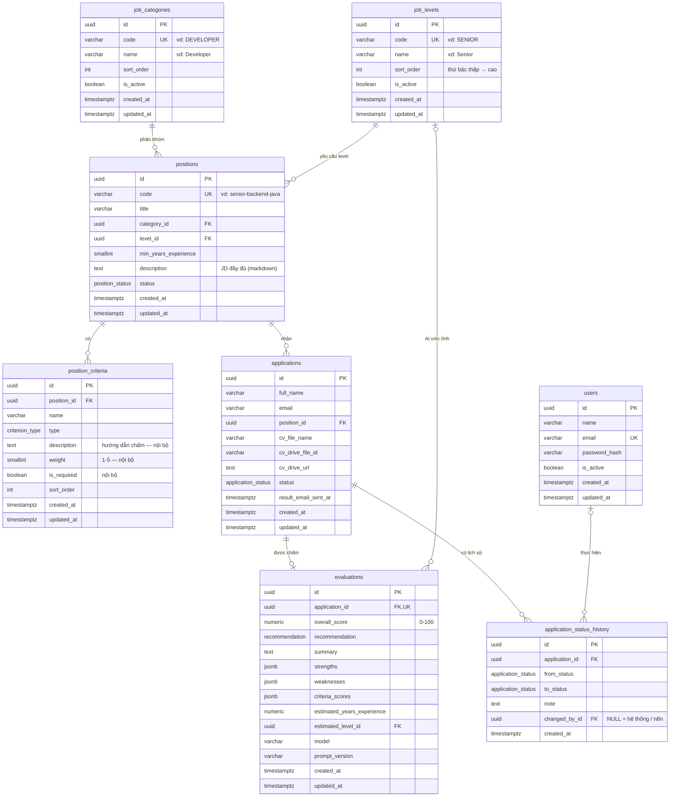

# Thiết kế Database — CV AI Scanner

> **v1.0 (2026-11-04)** — đã áp dụng: [`schema.prisma`](../packages/backend/prisma/schema.prisma), migration `20261104142813_init`. Mọi thay đổi tiếp theo phải cập nhật tài liệu này **và** tạo migration mới.
> Bối cảnh & luồng nghiệp vụ: [project-overview.md](./project-overview.md)

---

## 1. Nguyên tắc thiết kế

- **Gọn cho MVP:** 8 bảng, 4 enum.
- **Chỉ tách thành cột những thông tin dùng để lọc hoặc chấm điểm.** Thông tin chỉ để hiển thị (quyền lợi, địa điểm, mức lương…) nằm trong JD dạng markdown (`positions.description`).
- **Danh mục do HR tự quản lý thì dùng bảng tra cứu; danh sách cố định của hệ thống thì dùng enum.**
  - Nhóm vị trí (`job_categories`) và level (`job_levels`) là bảng — HR thêm / sửa trên giao diện, không cần migration.
  - Trạng thái, khuyến nghị, loại tiêu chí là enum — gắn với logic của backend / n8n nên không cho sửa tự do.
  - Bảng tra cứu không xoá cứng: ẩn bằng `is_active = false`. Các FK trỏ tới đều dùng `ON DELETE RESTRICT`.
- **Phân biệt dữ liệu công khai và nội bộ:** ứng viên chỉ thấy JD và tên / loại tiêu chí. Hướng dẫn chấm (`position_criteria.description`), trọng số và cờ bắt buộc chỉ HR và n8n dùng → API công khai không trả các cột này (D9).
- **DB là "hợp đồng" giữa backend (Prisma), n8n và MCP server (SQL thuần):**
  - Tên bảng / cột dạng `snake_case` (dùng `@map` / `@@map` như bảng `users` hiện có); giá trị enum dạng `UPPER_CASE`.
  - Tên enum trong Postgres cũng đặt `snake_case` (`@@map("application_status")`) để n8n cast cho dễ: `$1::application_status`.
- **Giá trị mặc định phải nằm ở DB, không nằm ở Prisma Client** — vì n8n INSERT/UPDATE trực tiếp:
  - `id`: dùng `@default(dbgenerated("gen_random_uuid()")) @db.Uuid` thay cho `@default(uuid())`. `uuid()` của Prisma được sinh ở phía client, nên khi n8n INSERT sẽ bị lỗi thiếu `id`.
  - `updated_at`: `@updatedAt` của Prisma cũng chỉ chạy ở client → khai báo thêm `@default(now())`, và n8n **phải tự `SET updated_at = now()`** mỗi khi UPDATE.
  - `created_at`: `@default(now())` là default thật của DB → không có vấn đề gì.
- **Lịch sử trạng thái:** mỗi lần đổi `applications.status` đều ghi kèm 1 dòng `application_status_history`.
- **Snapshot kết quả đánh giá:** điểm từng tiêu chí được lưu kèm tên và trọng số *tại thời điểm chấm*. HR sửa / xoá tiêu chí sau đó cũng không làm sai kết quả cũ.

---

## 2. Sơ đồ ERD



---

## 3. Enum

Nhóm vị trí và level **không** phải enum — xem bảng [`job_categories`](#42-job_categories--nhóm-vị-trí) và [`job_levels`](#43-job_levels--level).

| Enum | Giá trị | Ý nghĩa |
|------|---------|---------|
| `position_status` | `DRAFT` | HR đang soạn, ứng viên chưa thấy |
| | `OPEN` | Hiển thị ở `/jobs` và trên form nộp CV |
| | `CLOSED` | Ngừng nhận đơn; đơn cũ vẫn xem được |
| `criterion_type` | `TECHNICAL` | Kỹ năng kỹ thuật: ngôn ngữ, framework, công cụ (Java, TS, C#, Kafka, RabbitMQ, Docker…) |
| | `EXPERIENCE` | Kinh nghiệm thực tế / domain (microservices, hệ thống tải cao, fintech…) |
| | `SOFT_SKILL` | Giao tiếp, làm việc nhóm, phân tích nghiệp vụ… |
| | `LANGUAGE` | Ngoại ngữ |
| | `EDUCATION` | Học vấn, chứng chỉ (hay dùng cho Intern / Fresher) |
| `application_status` | `SUBMITTED` | Vừa nộp / chờ đánh giá |
| | `EVALUATING` | n8n đang xử lý |
| | `EVALUATED` | Đã có kết quả AI, chờ HR |
| | `EVALUATION_FAILED` | Đánh giá lỗi — chờ thử lại hoặc HR tự xem |
| | `ACCEPTED` | HR chấp nhận |
| | `REJECTED` | HR từ chối |
| `recommendation` | `RECOMMENDED` / `CONSIDER` / `NOT_RECOMMENDED` | Khuyến nghị của AI (quy tắc tính: [project-overview.md §7](./project-overview.md#cách-tính-điểm)) |

---

## 4. Chi tiết bảng

### Tổng quan chức năng

| Bảng | Chức năng chính | Ai ghi | Ai đọc |
|------|-----------------|--------|--------|
| `users` | Tài khoản đăng nhập của HR; xác định HR nào đã ra quyết định | Backend (seed, đổi mật khẩu) | Backend (đăng nhập), trang HR |
| `job_categories` | Danh mục nhóm vị trí (Developer, QA, BA…) — HR tự thêm | Backend (HR quản lý) | Trang công khai (lọc job), trang HR, MCP (Claude) |
| `job_levels` | Danh mục level có thứ bậc (Intern → Manager) — HR tự thêm | Backend (HR quản lý) | Trang công khai, trang HR, MCP (Claude), n8n |
| `positions` | Job đăng tuyển: tiêu đề, nhóm, level, số năm kinh nghiệm, JD; quyết định job nào đang nhận đơn | Backend (HR quản lý) | Trang công khai, trang HR, MCP (Claude) |
| `position_criteria` | "Thang chấm điểm" của từng job: tiêu chí, loại, trọng số, bắt buộc hay không | Backend (HR quản lý) | Trang công khai (chỉ tên + loại), trang HR, MCP (Claude), n8n (tính điểm) |
| `applications` | **Bảng trung tâm** — mỗi lần ứng viên nộp CV; trạng thái đơn; hàng đợi việc cho n8n | Backend, n8n (chỉ `status`) | Trang HR, n8n |
| `evaluations` | Kết quả AI chấm cho từng đơn: điểm, khuyến nghị, nhận xét, số năm & level ước tính | n8n | Trang HR |
| `application_status_history` | Nhật ký mọi lần đổi trạng thái + ghi chú quyết định của HR + lỗi đánh giá | Backend, n8n | Trang HR |

### Ví dụ: một đơn đi qua các bảng như thế nào

1. *(Một lần)* Seed sẵn nhóm vị trí và level. Sau này HR có thể thêm, vd nhóm "Data Engineer" → thêm 1 dòng `job_categories`.
2. HR tạo job "Senior Backend Developer (Java)" — nhóm Developer, level Senior, từ 5 năm → 1 dòng `positions` (`DRAFT`) + 5 dòng `position_criteria`. Khi mở tuyển → `positions.status = OPEN` → job xuất hiện ở `/jobs`.
3. Ứng viên A xem `/jobs`, bấm "Ứng tuyển", nộp CV → backend upload CV lên Drive → 1 dòng `applications` (`SUBMITTED`) + 1 dòng `application_status_history` (`NULL → SUBMITTED`).
4. 00:00 đêm đó, n8n nhận đơn → `applications.status = EVALUATING` + 1 dòng lịch sử.
5. Claude gọi tool MCP đọc `positions` + `position_criteria` + `job_levels`, chấm CV → n8n lưu 1 dòng `evaluations` (kèm ước tính: 3.5 năm, level Middle); `applications.status = EVALUATED` + 1 dòng lịch sử.
6. Sáng hôm sau, HR accept kèm ghi chú → `applications.status = ACCEPTED` + 1 dòng lịch sử (`changed_by_id` = id của HR đó, `note` = ghi chú).
7. Backend gửi email kết quả theo mẫu → `applications.result_email_sent_at = now()`.
8. Một tháng sau, ứng viên A nộp tiếp vào job khác → thêm 1 dòng `applications` mới, cùng email. HR thấy được cả 2 đơn.

### 4.1 `users` — tài khoản HR

**Chức năng**
- Lưu tài khoản HR để đăng nhập vào trang HR (email + mật khẩu đã hash).
- Ghi nhận **ai đã làm gì**: mỗi khi HR accept / reject hoặc yêu cầu đánh giá lại, `id` của HR được lưu vào `application_status_history.changed_by_id`.
- Khoá tài khoản của HR đã nghỉ bằng `is_active = false` mà vẫn giữ được lịch sử các quyết định của người đó.
- Ứng viên **không** có dòng nào trong bảng này (ứng viên không có tài khoản — D1).

**Ai dùng:** chỉ backend (đăng nhập, JWT guard; tài khoản tạo bằng seed). n8n không truy cập. Bảng đã có sẵn, chỉ bổ sung thêm cột.

| Cột | Kiểu | Ràng buộc | Ghi chú |
|-----|------|-----------|---------|
| `id` | uuid | PK, default `gen_random_uuid()` | Hiện đang là `String @default(uuid())` → đổi cho đồng bộ |
| `name` | varchar(255) | NOT NULL | |
| `email` | varchar(255) | NOT NULL, UNIQUE | Lưu chữ thường |
| `password_hash` | varchar(255) | NOT NULL | **Mới** — bcrypt / argon2 |
| `is_active` | boolean | NOT NULL, default `true` | **Mới** — khoá tài khoản thay vì xoá |
| `created_at` / `updated_at` | timestamptz | NOT NULL, default `now()` | |

### 4.2 `job_categories` — nhóm vị trí

**Chức năng**
- Danh mục nhóm vị trí: Developer, QA, BA, DevOps, PM, Designer, Data… HR tự thêm khi công ty tuyển nhóm mới (D7).
- Dùng để lọc job ở trang `/jobs` và lọc đơn ở trang HR.
- Thống kê theo nhóm (vd: số đơn QA trong tháng).

**Ai dùng:** ghi — backend (HR quản lý danh mục); đọc — trang công khai, trang HR, MCP (Claude dùng làm ngữ cảnh khi chấm).

| Cột | Kiểu | Ràng buộc | Ghi chú |
|-----|------|-----------|---------|
| `id` | uuid | PK | |
| `code` | varchar(64) | NOT NULL, UNIQUE | Mã ổn định, vd `DEVELOPER`. Backend tự sinh từ tên nếu HR không nhập |
| `name` | varchar(255) | NOT NULL | Tên hiển thị, vd "Developer" |
| `sort_order` | int | NOT NULL, default `0` | Thứ tự trong dropdown / bộ lọc |
| `is_active` | boolean | NOT NULL, default `true` | `false` = ẩn khỏi dropdown, job cũ vẫn giữ nguyên |
| `created_at` / `updated_at` | timestamptz | NOT NULL, default `now()` | |

Seed ban đầu: `DEVELOPER`, `QA`, `BA`, `DEVOPS`, `PM`, `DESIGNER`, `DATA`.

### 4.3 `job_levels` — level

**Chức năng**
- Danh mục level: Intern, Fresher, Junior, Middle, Senior, Lead, Manager… HR có thể thêm hoặc đổi tên (D7).
- `sort_order` là **thứ bậc** từ thấp đến cao → so sánh được level AI ước tính với level job yêu cầu (vd: ứng viên Middle < yêu cầu Senior).
- Là ngữ cảnh khi Claude chấm: cùng một kỹ năng, kỳ vọng với Senior cao hơn với Junior.
- Tool MCP trả danh sách level (mã + tên) cho Claude để Claude chọn level phù hợp nhất với ứng viên. Khi lưu kết quả, n8n đổi mã level Claude trả về thành `id`.

**Ai dùng:** ghi — backend (HR quản lý danh mục); đọc — trang công khai, trang HR, MCP (Claude), n8n WF-1 (lưu level ước tính).

| Cột | Kiểu | Ràng buộc | Ghi chú |
|-----|------|-----------|---------|
| `id` | uuid | PK | |
| `code` | varchar(64) | NOT NULL, UNIQUE | Mã ổn định, vd `SENIOR` — Claude trả về mã này khi ước tính level |
| `name` | varchar(255) | NOT NULL | Tên hiển thị |
| `sort_order` | int | NOT NULL | Thứ bậc: số nhỏ = level thấp |
| `is_active` | boolean | NOT NULL, default `true` | |
| `created_at` / `updated_at` | timestamptz | NOT NULL, default `now()` | |

Seed ban đầu (bước nhảy 10 để sau này chèn level mới vào giữa mà không phải đánh số lại):

| `code` | `INTERN` | `FRESHER` | `JUNIOR` | `MIDDLE` | `SENIOR` | `LEAD` | `MANAGER` |
|--------|----------|-----------|----------|----------|----------|--------|-----------|
| `sort_order` | 10 | 20 | 30 | 40 | 50 | 60 | 70 |

### 4.4 `positions` — job đăng tuyển

**Chức năng**
- Mô tả một job theo mẫu tin tuyển dụng: tiêu đề, nhóm, level, số năm kinh nghiệm tối thiểu, JD — thay cho danh sách hardcode ở frontend (D6).
- **1 job = 1 level** (D6). Muốn tuyển cả Junior và Middle thì tạo 2 job, mỗi job có thang chấm riêng → đánh giá chính xác hơn.
- Là nguồn dữ liệu cho trang `/jobs` (tóm tắt các job `OPEN`, lọc theo nhóm / level) và form `/submit-cv` (dropdown "Position" + JD đầy đủ của job đang chọn — D10).
- Lưu JD (`description`): hiển thị cho ứng viên, đồng thời là ngữ cảnh Claude đọc qua MCP khi chấm CV. Thông tin chỉ để hiển thị (quyền lợi, địa điểm, lương…) viết luôn trong JD.
- Điều khiển việc nhận đơn qua `status`: `DRAFT` (soạn nháp) → `OPEN` (nhận đơn) → `CLOSED` (ngừng nhận, đơn cũ vẫn xem được).

**Ai dùng:** ghi — backend (HR tạo / sửa / mở / đóng job); đọc — trang công khai, trang HR, MCP (Claude).

| Cột | Kiểu | Ràng buộc | Ghi chú |
|-----|------|-----------|---------|
| `id` | uuid | PK | |
| `code` | varchar(64) | NOT NULL, UNIQUE | Slug dễ đọc, vd `senior-backend-java` — dùng trong URL `/submit-cv?position=<code>` |
| `title` | varchar(255) | NOT NULL | vd "Senior Backend Developer (Java)" — chuyên môn hẹp (Backend, Mobile…) ghi ở đây |
| `category_id` | uuid | FK → `job_categories.id`, ON DELETE RESTRICT | |
| `level_id` | uuid | FK → `job_levels.id`, ON DELETE RESTRICT | |
| `min_years_experience` | smallint | NOT NULL, default `0`, ≥ 0 | Số năm kinh nghiệm tối thiểu; hiển thị cho ứng viên và gửi cho Claude |
| `description` | text | NOT NULL | JD đầy đủ (markdown) |
| `status` | position_status | NOT NULL, default `DRAFT` | |
| `created_at` / `updated_at` | timestamptz | NOT NULL, default `now()` | |

### 4.5 `position_criteria` — tiêu chí đánh giá

**Chức năng**
- Là **thang chấm điểm** của mỗi job: danh sách tiêu chí mà Claude sẽ chấm lần lượt (0–10 điểm mỗi tiêu chí).
- `type` phân loại tiêu chí giống các mục trong tin tuyển dụng (kỹ thuật, kinh nghiệm, kỹ năng mềm…) → hiển thị theo nhóm, và giúp chấm được cả các vị trí không thiên về kỹ thuật (BA, Intern).
- `description` là hướng dẫn chấm cụ thể cho Claude → các CV được chấm theo cùng một chuẩn, kết quả nhất quán và so sánh được.
- `weight` + `is_required` là đầu vào để n8n tính điểm tổng và khuyến nghị (công thức: [project-overview.md §7](./project-overview.md#cách-tính-điểm)).
- **Ứng viên chỉ thấy `name` (nhóm theo `type`).** `description`, `weight`, `is_required` là dữ liệu nội bộ (D9).

**Ai dùng:** ghi — backend (HR thêm / sửa / xoá tiêu chí); đọc — trang công khai (chỉ `name`, `type`), trang HR, MCP (Claude đọc để chấm), n8n WF-1 (đọc lại tên / trọng số để kiểm tra và tính điểm).

| Cột | Kiểu | Ràng buộc | Ghi chú |
|-----|------|-----------|---------|
| `id` | uuid | PK | |
| `position_id` | uuid | FK → `positions.id`, ON DELETE CASCADE | |
| `name` | varchar(255) | NOT NULL | vd "Java, Spring Boot" — **công khai** |
| `type` | criterion_type | NOT NULL, default `TECHNICAL` | **Công khai** |
| `description` | text | NULL | Hướng dẫn chấm, vd "≥ 3 năm dùng Java trong dự án production" — nội bộ |
| `weight` | smallint | NOT NULL, default `1`, 1–5 | Trọng số tương đối *(xem DQ3)* — nội bộ |
| `is_required` | boolean | NOT NULL, default `false` | Tiêu chí bắt buộc — dưới ngưỡng thì khuyến nghị `NOT_RECOMMENDED` — nội bộ |
| `sort_order` | int | NOT NULL, default `0` | Thứ tự hiển thị |
| `created_at` / `updated_at` | timestamptz | NOT NULL, default `now()` | |

Ví dụ — job "Senior Backend Developer (Java)", nhóm Developer, level Senior, từ 5 năm:

| `name` | `type` | `weight` | `is_required` |
|--------|--------|----------|---------------|
| Java, Spring Boot | TECHNICAL | 5 | ✔ |
| Message queue: Kafka hoặc RabbitMQ | TECHNICAL | 3 | ✔ |
| Thiết kế microservices, hệ thống tải cao | EXPERIENCE | 4 | ✔ |
| Docker, CI/CD | TECHNICAL | 2 | |
| Đọc hiểu tài liệu tiếng Anh | LANGUAGE | 1 | |

> Tên kỹ năng viết tự do trong tiêu chí (chưa có danh mục kỹ năng dùng chung) — nhờ vậy diễn đạt được cả kiểu "Kafka **hoặc** RabbitMQ".

### 4.6 `applications` — đơn ứng tuyển

**Chức năng**
- **Bảng trung tâm** của hệ thống: mỗi lần ứng viên submit form tạo ra **1 dòng** (họ tên, email, job, CV). Một email có thể có nhiều dòng.
- File CV được backend upload lên Google Drive ngay khi submit (D14). Bảng chỉ lưu "địa chỉ" của file (`cv_drive_file_id` để n8n tải, `cv_drive_url` để HR xem), bản thân file không nằm trong DB.
- `status` cho biết đơn đang ở bước nào. Cột này vừa là trạng thái hiển thị cho HR, vừa là **hàng đợi việc** cho n8n (WF-1 lúc 00:00 lấy các đơn `SUBMITTED`).
- `result_email_sent_at`: backend đánh dấu đã gửi email kết quả. Đơn đã có quyết định mà cột này còn `NULL` → email gửi lỗi, HR bấm "Gửi lại".
- Gom các đơn cùng email để HR biết ứng viên đã nộp những lần nào, vào job nào.
- Nhóm và level của đơn lấy qua `position_id` (join) — không copy sang bảng này.

**Ai dùng:** ghi — backend (tạo đơn khi submit; đổi `status` khi HR quyết định / yêu cầu đánh giá lại; `result_email_sent_at` sau khi gửi email), n8n (chỉ `status`, `updated_at`); đọc — trang HR (danh sách, chi tiết), n8n. MCP **không** đọc được bảng này.

| Cột | Kiểu | Ràng buộc | Ghi chú |
|-----|------|-----------|---------|
| `id` | uuid | PK | |
| `full_name` | varchar(255) | NOT NULL | |
| `email` | varchar(255) | NOT NULL | Không unique. Lưu chữ thường để gom các đơn của cùng 1 người |
| `position_id` | uuid | FK → `positions.id`, ON DELETE RESTRICT | Không cho xoá job đã có đơn — chỉ đóng (`CLOSED`) |
| `cv_file_name` | varchar(255) | NOT NULL | Tên file gốc ứng viên upload |
| `cv_drive_file_id` | varchar(128) | NOT NULL | n8n dùng ID này để tải file (node Google Drive tải theo ID) |
| `cv_drive_url` | text | NOT NULL | Link để HR mở xem |
| `status` | application_status | NOT NULL, default `SUBMITTED` | |
| `result_email_sent_at` | timestamptz | NULL | NULL = chưa gửi email kết quả. Chống gửi trùng |
| `created_at` | timestamptz | NOT NULL, default `now()` | = thời điểm nộp |
| `updated_at` | timestamptz | NOT NULL, default `now()` | n8n tự set khi UPDATE; dùng để phát hiện đơn treo ở `EVALUATING` |

> Lưu cả `cv_drive_file_id` và `cv_drive_url`: link dành cho người xem, còn ID dành cho API. Nếu chỉ lưu link thì n8n phải tự tách ID ra từ link.

### 4.7 `evaluations` — kết quả đánh giá AI

**Chức năng**
- Lưu kết quả Claude chấm cho 1 đơn: điểm tổng, khuyến nghị, nhận xét tổng quan, điểm mạnh / yếu, điểm và lý do của từng tiêu chí.
- Lưu **số năm kinh nghiệm và level do Claude ước tính** từ CV → HR thấy ngay "AI ước tính: 3.5 năm, Middle" cạnh "Yêu cầu: Senior, từ 5 năm".
- Là dữ liệu chính giúp HR quyết định nhanh: sắp xếp danh sách đơn theo điểm, lọc theo khuyến nghị, xem lý do từng tiêu chí ở trang chi tiết.
- Snapshot tiêu chí trong `criteria_scores` → kết quả vẫn đúng dù sau đó HR sửa tiêu chí.
- `model` + `prompt_version` dùng để truy vết và so sánh chất lượng khi đổi model hoặc chỉnh prompt.
- Tách riêng khỏi `applications` để phân rõ trách nhiệm: n8n là bên **duy nhất** ghi bảng này.

**Ai dùng:** ghi — n8n WF-1; đọc — trang HR. **Quan hệ 1–1 với `applications`** *(xem DQ1)*: khi đánh giá lại thì ghi đè (upsert).

| Cột | Kiểu | Ràng buộc | Ghi chú |
|-----|------|-----------|---------|
| `id` | uuid | PK | |
| `application_id` | uuid | FK → `applications.id`, UNIQUE, ON DELETE CASCADE | |
| `overall_score` | numeric(5,2) | NOT NULL, 0–100 | Do n8n tính từ `criteria_scores`, không phải Claude |
| `recommendation` | recommendation | NOT NULL | |
| `summary` | text | NOT NULL | Nhận xét tổng quan |
| `strengths` | jsonb | NOT NULL, default `'[]'` | Mảng string |
| `weaknesses` | jsonb | NOT NULL, default `'[]'` | Mảng string |
| `criteria_scores` | jsonb | NOT NULL | Điểm từng tiêu chí + snapshot tiêu chí. n8n lấy tên / trọng số từ DB, không lấy từ output của Claude — cấu trúc bên dưới *(xem DQ2)* |
| `estimated_years_experience` | numeric(4,1) | NULL | Tổng số năm kinh nghiệm Claude ước tính; NULL nếu CV không đủ thông tin |
| `estimated_level_id` | uuid | FK → `job_levels.id`, NULL, ON DELETE SET NULL | Level Claude ước tính |
| `model` | varchar(64) | NOT NULL | vd `claude-opus-5-5`. Field Prisma tên là `aiModel` (`@map("model")`) |
| `prompt_version` | varchar(32) | NOT NULL | vd `v1` — để so sánh khi chỉnh prompt |
| `created_at` / `updated_at` | timestamptz | NOT NULL, default `now()` | `updated_at` = lần chấm gần nhất |

Cấu trúc `criteria_scores`:

```json
[
  {
    "criterion_id": "3f1c…",
    "name": "Java, Spring Boot",
    "type": "TECHNICAL",
    "weight": 5,
    "is_required": true,
    "score": 8,
    "reasoning": "4 năm làm Java/Spring Boot, có dự án chạy production",
    "evidence": "…trích ngắn từ CV…"
  }
]
```

### 4.8 `application_status_history` — lịch sử trạng thái & ghi chú quyết định

**Chức năng**
- Nhật ký (audit log) của **mọi** lần đơn đổi trạng thái: đổi từ đâu sang đâu, ai làm, lúc nào.
- Lưu ghi chú / lý do của HR khi accept / reject (chức năng "Ghi chú & lịch sử quyết định" — D5).
- Lưu thông báo lỗi khi n8n đánh giá thất bại → biết vì sao đơn rơi vào `EVALUATION_FAILED`.
- Hiển thị dạng timeline ở trang chi tiết đơn.
- Chỉ thêm, không sửa / xoá → lịch sử luôn đáng tin cậy.

**Ai dùng:** ghi — backend (thay đổi do HR, có `changed_by_id`) và n8n (thay đổi do hệ thống, `changed_by_id = NULL`); đọc — trang HR. **Chỉ INSERT, không UPDATE / DELETE.**

| Cột | Kiểu | Ràng buộc | Ghi chú |
|-----|------|-----------|---------|
| `id` | uuid | PK | |
| `application_id` | uuid | FK → `applications.id`, ON DELETE CASCADE | |
| `from_status` | application_status | NULL | NULL ở dòng đầu tiên (lúc nộp đơn) |
| `to_status` | application_status | NOT NULL | |
| `note` | text | NULL | Ghi chú của HR khi quyết định; hoặc thông báo lỗi khi đánh giá thất bại |
| `changed_by_id` | uuid | FK → `users.id`, NULL, ON DELETE SET NULL | NULL = hệ thống / n8n |
| `created_at` | timestamptz | NOT NULL, default `now()` | |

### 4.9 Index

| Bảng | Index | Phục vụ |
|------|-------|---------|
| `applications` | `(status, created_at)` | n8n lấy đơn `SUBMITTED` cũ nhất; HR lọc theo trạng thái |
| `applications` | `(position_id, created_at DESC)` | HR lọc theo job |
| `applications` | `(email)` | Gom các đơn của cùng 1 ứng viên |
| `position_criteria` | `(position_id, sort_order)` | Lấy tiêu chí của job |
| `application_status_history` | `(application_id, created_at)` | Timeline của đơn |
| `evaluations` | UNIQUE `(application_id)` | Quan hệ 1–1 + upsert của n8n |

`job_categories`, `job_levels`, `positions` là bảng nhỏ (vài chục dòng) → chỉ cần PK và UNIQUE `code`.

---

## 5. Hợp đồng truy vấn cho n8n

Các câu SQL mà n8n và MCP server dùng. **Khi đổi schema phải rà lại phần này.**

### 5.1 Nhận đơn (WF-1, bước 3)

Chuyển trạng thái và ghi lịch sử trong 1 câu lệnh. WF-1 chạy lặp câu này theo lô cho đến khi không còn đơn. `SKIP LOCKED` giúp 2 lần chạy chồng nhau không lấy trùng đơn.

```sql
WITH picked AS (
  SELECT id FROM applications
  WHERE status = 'SUBMITTED'
  ORDER BY created_at
  LIMIT 10                -- kích thước lô
  FOR UPDATE SKIP LOCKED
),
claimed AS (
  UPDATE applications a
  SET status = 'EVALUATING', updated_at = now()
  FROM picked
  WHERE a.id = picked.id
  RETURNING a.id, a.full_name, a.email, a.position_id, a.cv_drive_file_id
),
hist AS (
  INSERT INTO application_status_history (application_id, from_status, to_status, note)
  SELECT id, 'SUBMITTED'::application_status, 'EVALUATING'::application_status, 'n8n: bắt đầu đánh giá'
  FROM claimed
)
SELECT * FROM claimed;
```

### 5.2 Tool MCP `get_position_requirements`

Claude gọi tool này để lấy dữ liệu chấm điểm (WF-1, bước 5). Câu SQL chạy bằng role `mcp_readonly`.

```sql
SELECT p.title, p.description, p.min_years_experience,
       c.name AS category, l.code AS level_code, l.name AS level_name,
       json_agg(json_build_object(
         'id', pc.id, 'name', pc.name, 'type', pc.type, 'description', pc.description,
         'weight', pc.weight, 'is_required', pc.is_required
       ) ORDER BY pc.sort_order) AS criteria
FROM positions p
JOIN job_categories c ON c.id = p.category_id
JOIN job_levels l ON l.id = p.level_id
JOIN position_criteria pc ON pc.position_id = p.id
WHERE p.id = $1
GROUP BY p.id, c.name, l.code, l.name;
```

Tool trả kèm danh sách level để Claude chọn khi ước tính: `SELECT code, name FROM job_levels WHERE is_active ORDER BY sort_order`.

Ở bước 6, n8n đọc lại tiêu chí bằng role `n8n_app` để kiểm tra Claude chấm đủ và tính điểm:
`SELECT id, name, type, weight, is_required FROM position_criteria WHERE position_id = $1 ORDER BY sort_order`.

### 5.3 Lưu kết quả (WF-1, bước 7)

- `$9` là **mã** level Claude trả về (vd `MIDDLE`); nếu mã không khớp thì `estimated_level_id` = NULL.
- Điều kiện `status = 'EVALUATING'` đảm bảo n8n không ghi đè trạng thái nếu HR đã ra quyết định trong lúc đơn đang được đánh giá.

```sql
WITH ev AS (
  INSERT INTO evaluations (application_id, overall_score, recommendation, summary,
                           strengths, weaknesses, criteria_scores,
                           estimated_years_experience, estimated_level_id,
                           model, prompt_version)
  VALUES ($1, $2, $3::recommendation, $4, $5::jsonb, $6::jsonb, $7::jsonb,
          $8, (SELECT id FROM job_levels WHERE code = $9),
          $10, $11)
  ON CONFLICT (application_id) DO UPDATE SET
    overall_score              = EXCLUDED.overall_score,
    recommendation             = EXCLUDED.recommendation,
    summary                    = EXCLUDED.summary,
    strengths                  = EXCLUDED.strengths,
    weaknesses                 = EXCLUDED.weaknesses,
    criteria_scores            = EXCLUDED.criteria_scores,
    estimated_years_experience = EXCLUDED.estimated_years_experience,
    estimated_level_id         = EXCLUDED.estimated_level_id,
    model                      = EXCLUDED.model,
    prompt_version             = EXCLUDED.prompt_version,
    updated_at                 = now()
  RETURNING application_id
),
app AS (
  UPDATE applications
  SET status = 'EVALUATED', updated_at = now()
  WHERE id = (SELECT application_id FROM ev) AND status = 'EVALUATING'
  RETURNING id
)
INSERT INTO application_status_history (application_id, from_status, to_status, note)
SELECT id, 'EVALUATING'::application_status, 'EVALUATED'::application_status, 'n8n: đánh giá xong'
FROM app;
```

### 5.4 Các truy vấn khác

| Mục đích | Truy vấn (tóm tắt) |
|----------|--------------------|
| Đánh giá lỗi | `status = 'EVALUATION_FAILED'` (với điều kiện `status = 'EVALUATING'`) + lịch sử, `note` = thông báo lỗi |
| Trả đơn treo về hàng đợi (đầu mỗi lần chạy WF-1) | `status = 'SUBMITTED'` cho đơn `EVALUATING` có `updated_at < now() - interval '1 hour'` + lịch sử |

> Email kết quả do **backend** gửi (qua Prisma), không thuộc phần SQL của n8n.

---

## 6. Phân quyền DB cho n8n

n8n và MCP server mỗi bên dùng 1 role riêng, chỉ có đúng các quyền cần thiết:

```sql
-- WF-1 của n8n
CREATE ROLE n8n_app LOGIN PASSWORD '***';
GRANT SELECT ON job_levels, position_criteria, applications TO n8n_app;
GRANT UPDATE (status, updated_at) ON applications TO n8n_app;
GRANT SELECT, INSERT, UPDATE ON evaluations TO n8n_app;
GRANT INSERT ON application_status_history TO n8n_app;

-- MCP server (tool get_position_requirements): chỉ đọc dữ liệu job
CREATE ROLE mcp_readonly LOGIN PASSWORD '***';
GRANT SELECT ON job_categories, job_levels, positions, position_criteria TO mcp_readonly;
```

- `mcp_readonly` **không** có quyền đọc `applications` / `evaluations`. Nhờ vậy, kể cả khi CV chứa prompt injection, Claude cũng không lấy được dữ liệu của ứng viên khác.
- Nếu MCP server chạy trong n8n, workflow MCP dùng 1 Postgres credential riêng với role `mcp_readonly` (không dùng chung credential với WF-1).
- Đặt các lệnh `GRANT` trong 1 file Prisma migration (SQL thuần), vì bảng mới tạo sau này không tự động được cấp quyền.
- n8n lưu dữ liệu nội bộ của nó (workflow, credentials, execution log) trong **database riêng** (vd `n8n`, cấu hình `DB_TYPE=postgresdb`, `DB_POSTGRESDB_DATABASE=n8n`) trên cùng Postgres server, không dùng chung database của ứng dụng. Nếu dùng chung, `prisma migrate dev` sẽ coi các bảng của n8n là "drift" (lệch schema) và đề nghị reset DB.

---

## 7. Thay đổi so với hiện tại

| Hiện tại | Sau khi áp dụng |
|----------|-----------------|
| `users`: `id` (String, `uuid()` phía client), `name`, `email` | Thêm `password_hash`, `is_active`; `id` chuyển sang `@db.Uuid` + default ở DB |
| Vị trí hardcode trong `packages/frontend/src/data/positions.ts` (chỉ có `id`, `title`, `requirements[]`) | 4 bảng `job_categories`, `job_levels`, `positions`, `position_criteria`. Seed lại 3 vị trí hiện có (`frontend-dev`, `backend-dev`, `fullstack-dev`) vào nhóm Developer, level / số năm tạm đặt Middle / 2 năm — HR sửa lại sau |
| Form nhận `.pdf/.doc/.docx` | Chỉ nhận `.pdf` |
| `POST /api/submit-cv` (mock trong Next.js) | `POST /api/applications` ở backend |

---

## 8. Câu hỏi mở về database

| # | Câu hỏi | Đề xuất |
|---|---------|---------|
| DQ1 | **Có cần giữ lịch sử các lần đánh giá không?** (a) 1–1, đánh giá lại thì ghi đè; (b) 1–n, giữ mọi lần chấm. | (a) — đơn giản cho cả n8n (upsert) lẫn trang HR (join, sắp xếp theo điểm). Execution log của n8n vẫn giữ lại các lần chạy cũ. Nếu sau này cần (b) thì chỉ việc bỏ ràng buộc UNIQUE. |
| DQ2 | **Điểm từng tiêu chí lưu ở JSONB hay ở bảng riêng `evaluation_scores`?** | JSONB — n8n chỉ cần 1 câu INSERT; HR chỉ cần hiển thị chứ không truy vấn sâu theo từng tiêu chí. |
| DQ3 | **Trọng số tính thế nào?** (a) số nguyên 1–5, tương đối; (b) phần trăm, tổng phải bằng 100. | (a) — HR không phải canh cho tổng = 100 mỗi lần thêm hoặc xoá tiêu chí. |
| DQ4 | **Form có cần thêm trường không?** (số điện thoại, link LinkedIn / portfolio, lời nhắn…) | Chưa cần cho MVP — giữ đúng 4 trường như hiện tại. |
| DQ5 | **Ghi chú của HR** chỉ gắn với lần quyết định (cột `note` trong lịch sử), hay cần thêm bảng ghi chú tự do (nhiều HR trao đổi về 1 đơn)? | Chỉ gắn với quyết định cho MVP. |
| DQ6 | **Ngưỡng khuyến nghị** (75 / 50, tiêu chí bắt buộc ≥ 5) cố định trong n8n hay cho HR chỉnh theo từng job? | Cố định trong n8n cho MVP. |
| DQ7 | **Loại tiêu chí** (`criterion_type`) có cần cho HR tự thêm như nhóm / level không? | ✅ **Đã chốt (D11):** không — giữ enum 5 loại. |
| DQ8 | **Số năm & level AI ước tính có ảnh hưởng khuyến nghị không?** | ✅ **Đã chốt (D12):** chỉ hiển thị cho HR tham khảo trong MVP. |
| DQ9 | **Mẫu email kết quả lưu ở đâu?** (a) file template trong backend; (b) bảng `email_templates` để HR sửa nội dung trên UI. | ✅ **Đã chốt (D18):** (a) file template trong backend — HR không sửa nội dung, không cần thêm bảng. |
