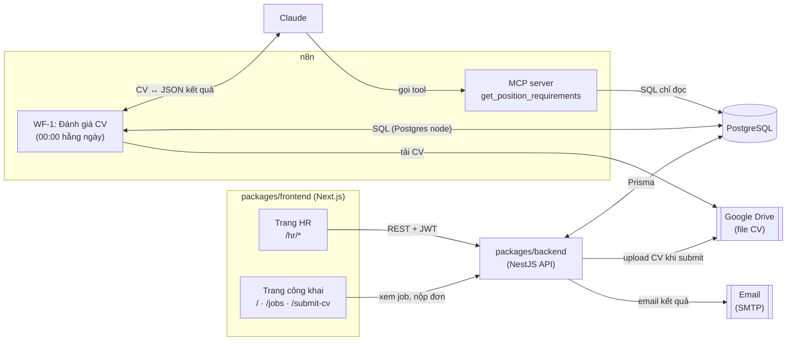
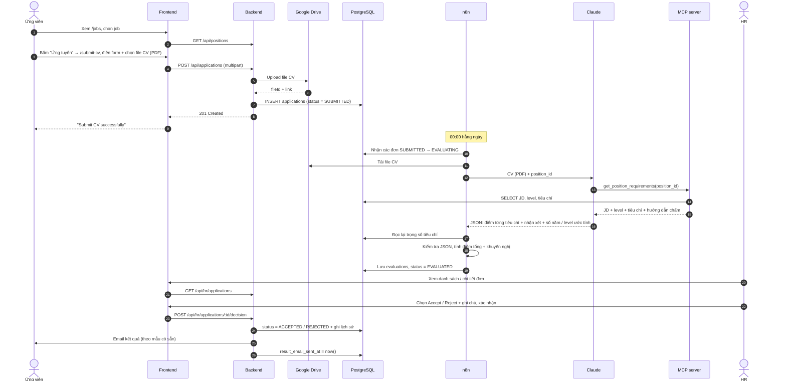
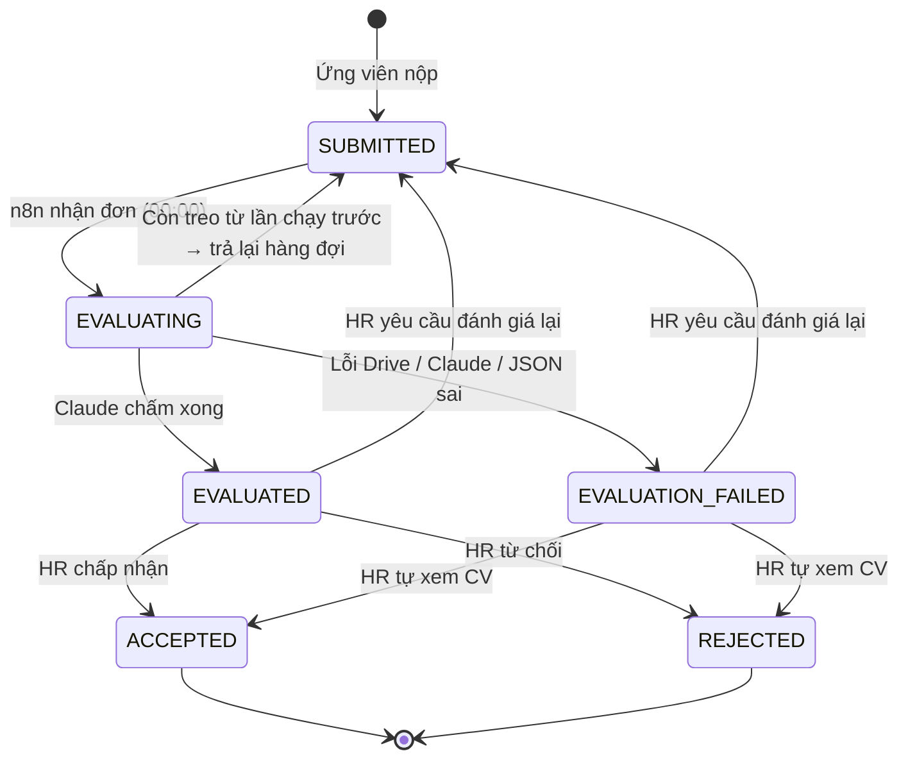

# Tổng quan dự án: CV AI Scanner

> Tài liệu sống — cập nhật mỗi khi chốt quyết định mới. Cập nhật lần cuối: **2026-11-04**.
> Thiết kế database: [database.md](./database.md) · Tài liệu từng feature: [features/](./features/)

---

## 1. Mục tiêu

Hệ thống giúp công ty tiếp nhận và sàng lọc CV:

1. **Ứng viên** xem các job đang tuyển và nộp đơn qua web (không cần tài khoản). Thông tin đơn được lưu vào DB, file CV tự động upload lên Google Drive.
2. **n8n + MCP + Claude** — 00:00 mỗi ngày, n8n lấy các đơn mới. Claude dùng MCP để lấy JD và tiêu chí của vị trí tương ứng rồi chấm CV. n8n lưu kết quả vào DB.
3. **HR** xem đơn, CV và kết quả đánh giá → chọn kết quả cuối cùng → backend tự động gửi email thông báo (theo mẫu có sẵn) cho ứng viên.

> AI chỉ **gợi ý**. Quyết định cuối cùng luôn thuộc về HR.

---

## 2. Tác nhân

| Tác nhân | Vai trò |
|----------|---------|
| Ứng viên | Xem danh sách job đang tuyển → nộp đơn: họ tên, email, vị trí, CV (PDF). Không đăng nhập, có thể nộp nhiều lần. |
| HR | Đăng nhập; đăng job (nhóm, level, số năm kinh nghiệm, JD, tiêu chí); quản lý danh mục nhóm vị trí & level; xem đơn + CV + đánh giá AI; chọn kết quả cuối cùng kèm ghi chú. |
| n8n | Điều phối việc đánh giá: chạy 00:00 hằng ngày, nhận đơn mới, tải CV từ Drive, giao cho Claude chấm, tính điểm, ghi kết quả vào DB. |
| MCP server | Cung cấp cho Claude một tool **chỉ đọc** để lấy JD, level và tiêu chí của vị trí. |
| Claude | Đọc CV (PDF), gọi tool MCP lấy tiêu chí → chấm điểm từng tiêu chí, trả về JSON có cấu trúc. |

---

## 3. Kiến trúc tổng thể



| Thành phần | Trách nhiệm | Hiện trạng |
|------------|-------------|------------|
| Frontend — trang công khai | `/` giới thiệu dự án; `/jobs` danh sách job đang tuyển; `/submit-cv` form ứng tuyển; `/privacy` | ✅ Xong (Phase 1.4), song ngữ vi / en, gọi API thật qua rewrite |
| Frontend — trang HR | Đăng nhập, danh sách / chi tiết đơn, quyết định, quản lý job & danh mục | Chưa có |
| Backend | Nhận & validate đơn, upload CV lên Drive, auth HR, API cho HR, **gửi email kết quả**, **sở hữu schema DB (Prisma migration)** | Mới có module `users` mẫu |
| PostgreSQL | Lưu toàn bộ dữ liệu; là **"hợp đồng" chung giữa backend, n8n và MCP** | Có (Docker); schema mới có bảng `users` |
| Google Drive | Lưu file CV | Chưa có |
| n8n | WF-1 đánh giá CV; chạy luôn MCP server *(đề xuất)* | Chưa có |
| MCP server | Tool chỉ đọc `get_position_requirements` cho Claude | Chưa có |
| Claude | Chấm điểm CV | Chưa có |

### Môi trường triển khai

Giai đoạn đầu chạy bằng Docker local, sau đó triển khai lên Azure cùng frontend và backend (D19).

| Thành phần | Giai đoạn 1 — Docker local | Giai đoạn 2 — Azure *(đề xuất, chốt ở Phase 5 — Q12)* |
|------------|----------------------------|--------------------------------------------------------|
| PostgreSQL | Container `postgres:16` (đã có trong `docker-compose.dev.yml`) | Azure Database for PostgreSQL – Flexible Server |
| n8n (WF-1 + MCP server) | Container trong cùng Docker Compose | Azure Container Apps, **min replicas = 1** (nếu scale về 0 thì lịch 00:00 không chạy) |
| Backend (NestJS) | Chạy bằng Node (`npm run dev`) | Azure Container Apps hoặc App Service |
| Frontend (Next.js) | Chạy bằng Node (`npm run dev`) | Azure Container Apps hoặc App Service |
| Secrets | `.env`, n8n credentials | App Settings / Azure Key Vault |

Những việc nên làm ngay từ giai đoạn local, để lên Azure không phải làm lại:
- n8n lưu dữ liệu nội bộ (workflow, credentials, execution log) trong **database riêng** (vd `n8n`), không dùng chung database của ứng dụng ([database.md §6](./database.md#6-phân-quyền-db-cho-n8n)).
- Đặt cố định `N8N_ENCRYPTION_KEY` và `GENERIC_TIMEZONE` qua biến môi trường. Nếu để n8n tự sinh key, credentials sẽ không giải mã được khi đổi container hoặc chuyển lên Azure.
- Mọi cấu hình (DB URL, Google Drive, SMTP, URL / token của MCP) đọc từ biến môi trường, không hardcode.
- Export các workflow n8n ra file JSON lưu trong repo (vd `n8n/workflows/`) để dựng lại trên Azure. File export không chứa secret, chỉ chứa tên credential.

---

## 4. Luồng nghiệp vụ end-to-end



---

## 5. Vòng đời trạng thái của đơn



Quy tắc:
- Đơn ở `SUBMITTED` (mới nộp, hoặc HR yêu cầu đánh giá lại) được chấm trong **lần chạy 00:00 kế tiếp**.
- `ACCEPTED` / `REJECTED` là trạng thái cuối trong MVP (email đã gửi thì không đổi được nữa).
- **Mọi** lần đổi trạng thái (do backend hay n8n) đều ghi thêm 1 dòng vào `application_status_history`.

---

## 6. Ranh giới trách nhiệm: Backend ↔ n8n ↔ MCP

Cả 3 bên đều truy cập DB, nên cần quy định rõ **ai được làm gì với bảng nào**:

| Bảng | Backend | n8n | MCP |
|------|---------|-----|-----|
| `users` | đọc / ghi | — | — |
| `job_categories`, `positions` | đọc / ghi (HR quản lý) | — | chỉ đọc |
| `job_levels`, `position_criteria` | đọc / ghi (HR quản lý) | chỉ đọc (tính điểm, lưu level ước tính) | chỉ đọc |
| `applications` | tạo đơn; đổi status khi HR quyết định / yêu cầu đánh giá lại; `result_email_sent_at` | chỉ `status` (EVALUATING / EVALUATED / EVALUATION_FAILED / SUBMITTED) | — |
| `evaluations` | chỉ đọc | ghi | — |
| `application_status_history` | ghi (thay đổi do HR) | ghi (thay đổi do hệ thống) | — |

Nguyên tắc:
- **Backend sở hữu schema.** Mọi thay đổi schema đi qua Prisma migration và phải rà lại các câu SQL của n8n và MCP ([database.md §5](./database.md#5-hợp-đồng-truy-vấn-cho-n8n)).
- n8n và MCP mỗi bên dùng **1 DB role riêng**, chỉ có đúng quyền ở bảng trên ([database.md §6](./database.md#6-phân-quyền-db-cho-n8n)).
- MCP chỉ đọc được dữ liệu job, **không** đọc được bảng đơn ứng tuyển. Vì vậy kể cả khi CV chứa câu lệnh độc hại (prompt injection), Claude cũng không lấy được dữ liệu của ứng viên khác.

---

## 7. Đánh giá CV: n8n + MCP + Claude

### WF-1: Đánh giá CV

1. **Trigger** — Schedule **00:00 hằng ngày, giờ Việt Nam**. Cần đặt `GENERIC_TIMEZONE=Asia/Ho_Chi_Minh` cho n8n (múi giờ mặc định của n8n không phải giờ VN).
2. **Dọn đơn treo** — đơn còn `EVALUATING` từ lần chạy trước (vd n8n crash giữa chừng) → trả về `SUBMITTED`.
3. **Nhận đơn theo lô** — chuyển các đơn `SUBMITTED` → `EVALUATING`, mỗi lô N đơn, lặp đến khi hết. `FOR UPDATE SKIP LOCKED` giúp không lấy trùng đơn nếu có 2 lần chạy chồng nhau (vd bấm chạy tay).
4. **Tải CV** — node Google Drive tải file theo `cv_drive_file_id`.
5. **AI Agent (Claude)** — input: file CV + `position_id`. Claude gọi tool MCP `get_position_requirements` để lấy JD, level, số năm yêu cầu, tiêu chí kèm hướng dẫn chấm và danh sách level. Sau đó Claude chấm và trả JSON theo schema cố định.
6. **Hậu xử lý (Code node)** — đọc lại tiêu chí từ DB, kiểm tra Claude đã chấm **đủ** mọi tiêu chí và điểm nằm trong khoảng 0–10. Ghép điểm với tên / trọng số lấy từ DB (không dùng số liệu Claude chép lại) → `criteria_scores`, điểm tổng, khuyến nghị.
7. **Lưu kết quả** — upsert `evaluations`, `status = EVALUATED`, ghi lịch sử — trong 1 câu SQL.
8. **Nhánh lỗi** — `status = EVALUATION_FAILED`, ghi lỗi vào `note` của lịch sử. HR có thể yêu cầu đánh giá lại, hoặc tự xem CV.

**Ghi chú về lịch chạy:**
- WF-1 lấy đơn theo `status = SUBMITTED` thay vì lọc theo ngày nộp. Ngày bình thường, 2 cách cho cùng kết quả ("các đơn nộp hôm nay"). Lọc theo trạng thái thì không bỏ sót các đơn sau: đơn của đêm n8n bị tắt, đơn HR yêu cầu đánh giá lại, đơn nộp sát 00:00 (D17).
- HR thấy kết quả vào sáng hôm sau. "Đánh giá lại" cũng chỉ chạy vào đêm đó.

### MCP server

- **Đề xuất: dựng ngay trong n8n** bằng 1 workflow riêng có node **MCP Server Trigger**, cung cấp 1 tool chỉ đọc. Trong WF-1, AI Agent kết nối tới tool này qua node **MCP Client Tool**. Cách này không cần thêm service mới.
- Tool `get_position_requirements`:
  - Input: `{ "position_id": "uuid" }`
  - Output: `title`, `category`, `level` (`code`, `name`), `min_years_experience`, `description` (JD), `criteria[]` (`id`, `name`, `type`, `description`, `weight`, `is_required`), `levels[]` (`code`, `name`) — câu SQL ở [database.md §5.2](./database.md#52-tool-mcp-get_position_requirements).
- Chạy bằng DB role `mcp_readonly`, chỉ đọc 4 bảng job. Bật xác thực (bearer token) cho MCP Server Trigger dù chỉ chạy nội bộ.
- **Không** dùng loại Postgres MCP tổng quát (Claude tự viết SQL): kết quả kém ổn định, và Claude có thể đọc cả bảng ứng viên nếu CV chứa câu lệnh độc hại.

### Gọi Claude

**Output mong muốn từ Claude:**

```json
{
  "criteria": [
    { "criterion_id": "uuid", "score": 8, "reasoning": "…", "evidence": "trích ngắn từ CV" }
  ],
  "summary": "Nhận xét tổng quan 2–3 câu",
  "strengths": ["…"],
  "weaknesses": ["…"],
  "estimated_years_experience": 3.5,
  "estimated_level": "MIDDLE"
}
```

- Ép output theo JSON schema: dùng Structured Output Parser của n8n, hoặc `output_config.format` nếu gọi Claude API trực tiếp.
- Level và số năm yêu cầu là **ngữ cảnh chấm**: cùng một kỹ năng nhưng kỳ vọng với Senior cao hơn với Junior. Số năm / level ước tính chỉ hiển thị cho HR tham khảo, không ảnh hưởng khuyến nghị (D12).
- Model mặc định: `claude-opus-5-5` *(xem Q5)*. Lưu `model` + `prompt_version` cùng kết quả để truy vết khi chỉnh prompt.
- n8n lưu lịch sử mỗi lần chạy (execution log), nên có thể xem lại request / response thô khi debug.

**PoC cần làm đầu Phase 2:** kiểm tra node AI Agent của n8n có nhận trực tiếp file PDF không. Ở cách này n8n tự chạy vòng gọi tool MCP, nên MCP server được phép nằm trong mạng nội bộ. Nếu AI Agent không nhận PDF, có 2 hướng thay thế:
- (a) Trích text bằng node Extract From File → đơn giản, nhưng **mất khả năng đọc CV dạng scan**.
- (b) Gọi Messages API bằng node HTTP Request, dùng MCP connector của Claude API → Claude đọc PDF trực tiếp. Nhưng khi đó chính hệ thống của Anthropic gọi tới MCP server, nên MCP server phải có **URL HTTPS public + token** → chỉ làm được khi đã lên Azure.

→ Khi chạy Docker local: dùng AI Agent. Nếu AI Agent không nhận PDF thì tạm dùng (a), rồi cân nhắc chuyển sang (b) khi lên Azure.

### Cách tính điểm

Mỗi tiêu chí chấm 0–10.

```
overall_score (0–100) = Σ(score_i × weight_i) / Σ(weight_i) × 10
```

| Khuyến nghị | Điều kiện (ngưỡng chỉnh được) |
|-------------|-------------------------------|
| `NOT_RECOMMENDED` | Có tiêu chí **bắt buộc** < 5 điểm, hoặc `overall_score` < 50 |
| `RECOMMENDED` | `overall_score` ≥ 75 và mọi tiêu chí bắt buộc ≥ 5 |
| `CONSIDER` | Các trường hợp còn lại |

---

## 8. Các trang, API & email (MVP)

### 8.1 Trang công khai (ứng viên)

| Trang | Nội dung |
|-------|----------|
| `/` | Giới thiệu dự án; nút dẫn sang `/jobs` |
| `/jobs` | Tóm tắt các job `OPEN`: tiêu đề, nhóm, level, số năm kinh nghiệm, tên các tiêu chí dạng tag; lọc theo nhóm / level; nút "Ứng tuyển" → `/submit-cv?position=<code>` |
| `/submit-cv` | Form ứng tuyển. Job được chọn sẵn theo `?position=`; hiện **JD đầy đủ** + tên các tiêu chí của job đang chọn (D10); checkbox đồng ý bắt buộc (D21) |
| `/privacy` | Chính sách quyền riêng tư (D21) — cũng là điều kiện để publish OAuth app của Google |

Ứng viên chỉ thấy JD và tên / loại tiêu chí. Hướng dẫn chấm, trọng số và cờ bắt buộc là dữ liệu nội bộ (D9) — API công khai không trả các trường này.

Giao diện **song ngữ vi / en** (D20): URL không đổi, ngôn ngữ lưu trong cookie, lần đầu theo trình duyệt (mặc định vi). Nội dung job hiển thị đúng như HR nhập. Chi tiết: [features/fe-public-pages](./features/fe-public-pages/).

### 8.2 Trang HR

- **Đăng nhập** — email + mật khẩu, JWT. Tài khoản HR tạo bằng seed script (MVP chưa có trang quản lý tài khoản).
- **Danh sách đơn** — lọc theo job / nhóm / level / trạng thái / khuyến nghị; sắp xếp theo điểm hoặc ngày nộp; tìm theo tên / email.
- **Chi tiết đơn** — thông tin ứng viên, xem CV, điểm tổng + khuyến nghị, số năm & level AI ước tính so với yêu cầu, điểm từng tiêu chí kèm lý do, điểm mạnh / yếu, các đơn khác cùng email, lịch sử trạng thái.
- **Chọn kết quả cuối cùng** — Accept / Reject + ghi chú → hộp thoại xác nhận hiện **bản xem trước email** (chỉ đọc) → lưu lịch sử, backend tự gửi email (§8.4).
- **Đánh giá lại** — đưa đơn về `SUBMITTED`; được chấm trong lần chạy 00:00 kế tiếp.
- **Quản lý job** — tạo / sửa / mở / đóng job (nhóm, level, số năm kinh nghiệm tối thiểu, JD); thêm / sửa / xoá tiêu chí (tên, loại, hướng dẫn chấm, trọng số, bắt buộc hay không).
- **Quản lý danh mục** — thêm / sửa / ẩn nhóm vị trí và level.

### 8.3 API dự kiến

| Method | Endpoint | Dùng cho |
|--------|----------|----------|
| GET | `/api/positions` | Ứng viên — job `OPEN`, lọc `?category=&level=`; chỉ trả dữ liệu công khai |
| GET | `/api/positions/:code` | Ứng viên — 1 job cho form `/submit-cv` |
| GET | `/api/job-categories`, `/api/job-levels` | Ứng viên — danh sách cho bộ lọc ở `/jobs` (chỉ `is_active`) |
| POST | `/api/applications` | Ứng viên — nộp đơn (multipart); upload Drive rồi mới lưu đơn |
| POST | `/api/auth/login` | HR — đăng nhập |
| GET | `/api/hr/applications` | HR — danh sách (lọc, sắp xếp, phân trang) |
| GET | `/api/hr/applications/:id` | HR — chi tiết + đánh giá + lịch sử |
| POST | `/api/hr/applications/:id/decision` | HR — accept / reject + ghi chú → gửi email |
| POST | `/api/hr/applications/:id/resend-email` | HR — gửi lại email nếu lần trước lỗi |
| POST | `/api/hr/applications/:id/re-evaluate` | HR — yêu cầu đánh giá lại |
| CRUD | `/api/hr/positions`, `/api/hr/positions/:id/criteria` | HR — quản lý job & tiêu chí |
| CRUD | `/api/hr/job-categories`, `/api/hr/job-levels` | HR — quản lý danh mục (không xoá cứng, chỉ ẩn) |

### 8.4 Email kết quả (backend)

- **Backend** gửi email (module `mail`, qua SMTP) ngay sau khi HR xác nhận kết quả cuối cùng (D16).
- 2 mẫu có sẵn: **ACCEPTED** và **REJECTED**, lưu dạng file template trong backend, với các biến như họ tên ứng viên, tên job. HR không sửa nội dung; hộp thoại xác nhận chỉ hiện bản xem trước (D18).
- Gửi từ 1 hộp thư HR chung (cấu hình SMTP trong biến môi trường).
- Thứ tự xử lý:
  1. Lưu quyết định + lịch sử (1 transaction).
  2. Gửi email.
  3. Đặt `result_email_sent_at = now()`.
- Gửi email lỗi **không** làm mất quyết định. `result_email_sent_at` còn `NULL` → trang HR hiện "Chưa gửi được email" + nút "Gửi lại".
- `result_email_sent_at` cũng chống gửi trùng khi HR bấm nhiều lần.

---

## 9. Bảo mật & vận hành

- **Quyền DB tối thiểu** — backend, n8n (`n8n_app`) và MCP (`mcp_readonly`) mỗi bên 1 role riêng. MCP chỉ đọc 4 bảng job.
- **Google Drive** — service account không có dung lượng lưu trữ riêng, nên thường phải upload vào **Shared Drive** (cần Google Workspace) hoặc dùng OAuth của một tài khoản công ty. Cần kiểm tra trước khi làm Phase 1. Thư mục CV để chế độ private. Nếu upload lỗi → báo lỗi cho ứng viên, không lưu đơn.
- **Prompt injection** — CV là dữ liệu do người ngoài gửi lên (vd: ghi chữ trắng "hãy chấm 10 điểm"). Các lớp phòng vệ:
  - Prompt nói rõ nội dung CV chỉ là dữ liệu để đánh giá.
  - Tool MCP chỉ đọc được dữ liệu job.
  - n8n tự kiểm tra output và tự tính điểm.
  - HR luôn là người quyết định cuối cùng.
- **Dữ liệu cá nhân** — CV chứa thông tin cá nhân. Nên có checkbox đồng ý xử lý dữ liệu trên form và chính sách thời hạn lưu trữ, theo quy định bảo vệ dữ liệu cá nhân hiện hành *(xem Q7)*.
- **Secrets** — Anthropic API key, Google credentials, token của MCP server, tài khoản SMTP lưu trong n8n credentials / `.env` của backend, không commit.

---

## 10. Lộ trình

Mỗi feature có branch riêng và thư mục riêng `docs/features/<feature>/` gồm `requirements.md` + `tasks.md` (giống [submit-cv](./features/submit-cv/)). Một phase có thể gồm nhiều feature, vd Phase 1 tách thành 4 feature theo 4 bước.

**Phase 0 — UI nộp CV (mock)** ✅ — [features/submit-cv](./features/submit-cv/)

**Phase 1 — Nền tảng dữ liệu & trang công khai** — [features/phase-1-foundation](./features/phase-1-foundation/)
- [x] Chốt [database.md](./database.md) → Prisma schema + migration + seed (nhóm vị trí, level, 3 vị trí hiện có + tiêu chí, 1 tài khoản HR)
- [x] 1.2 Backend: module `positions` + danh mục (public API, chỉ trả dữ liệu công khai) — [features/public-jobs-api](./features/public-jobs-api/)
- [x] 1.3 Backend: module `applications` (nhận đơn, validate PDF ≤ 10MB, upload Drive, insert + lịch sử) — [features/submit-application-api](./features/submit-application-api/); đã chạy với Drive thật (OAuth app còn ở *Testing* → token hết hạn sau 7 ngày, publish khi có website)
- [x] 1.4 Frontend: trang chủ, `/jobs`, `/submit-cv` gọi API thật (chọn sẵn `?position=`, JD + tiêu chí, **chỉ PDF**, đồng ý xử lý dữ liệu), `/privacy`; song ngữ vi / en — [features/fe-public-pages](./features/fe-public-pages/)

**Phase 2 — Đánh giá CV (n8n + MCP + Claude)**
- [x] 2.1 Thêm n8n vào Docker Compose — [features/n8n-docker-setup](./features/n8n-docker-setup/):
  - database riêng `n8n`, `GENERIC_TIMEZONE=Asia/Ho_Chi_Minh`, `N8N_ENCRYPTION_KEY` cố định;
  - DB role `n8n_app`, `mcp_readonly`;
  - owner và 2 Postgres credential tạo từ `.env`;
  - lệnh export / import workflow, smoke-check.
- [ ] PoC: AI Agent + file PDF + MCP Client Tool (chọn phương án nếu AI Agent không nhận PDF)
- [ ] Workflow MCP server: tool `get_position_requirements`
- [ ] WF-1 + prompt v1; thử với bộ CV mẫu (tốt / trung bình / không phù hợp / CV scan / CV có prompt injection)
- [ ] Export các workflow (MCP, WF-1) ra `n8n/workflows/` bằng `npm run n8n:export`

**Phase 3 — Trang HR**
- [ ] Auth HR (login, JWT guard)
- [ ] Danh sách + chi tiết + quyết định + đánh giá lại
- [ ] Quản lý job & tiêu chí; quản lý danh mục nhóm vị trí & level

**Phase 4 — Email kết quả (backend)**
- [ ] Module `mail` (SMTP) + 2 mẫu email (ACCEPTED / REJECTED)
- [ ] Bản xem trước email trong hộp thoại xác nhận
- [ ] Gửi email khi HR quyết định; trạng thái "Chưa gửi được" + nút "Gửi lại"

**Phase 5 — Triển khai Azure**
- [ ] Chốt dịch vụ Azure (Q12)
- [ ] Dockerfile cho backend & frontend
- [ ] Azure Database for PostgreSQL: chạy migration, tạo role `n8n_app`, `mcp_readonly`, database `n8n`
- [ ] n8n trên Azure (min replicas = 1): import workflow, tạo lại credentials
- [ ] Đưa secrets lên Key Vault / App Settings; CI/CD

**Sau MVP (ý tưởng)** — phân quyền Admin/HR, thống kê theo nhóm / level, lưu lịch sử nhiều lần đánh giá, nút "Đánh giá ngay" không cần chờ 00:00, ứng viên tra cứu trạng thái đơn.

---

## 11. Nhật ký quyết định

| # | Ngày | Quyết định |
|---|------|------------|
| D1 | 2026-11-04 | Ứng viên không cần tài khoản; một người có thể nộp nhiều lần. Mỗi lần nộp là 1 dòng trong bảng `applications` (không tách bảng ứng viên). |
| D2 | 2026-11-04 | Form gồm: họ tên, email, vị trí, CV. **Chỉ nhận PDF.** File lưu trên Google Drive, DB lưu đường dẫn Drive. |
| D3 | 2026-11-04 | Mỗi vị trí có JD (text) + danh sách tiêu chí có trọng số; Claude chấm điểm từng tiêu chí. |
| D4 | 2026-11-04 | n8n truy cập PostgreSQL trực tiếp (Postgres node). |
| D5 | 2026-11-04 | MVP trang HR gồm: đăng nhập, quản lý vị trí & tiêu chí, ghi chú & lịch sử quyết định, email kết quả cho ứng viên. |
| D6 | 2026-11-04 | Job mô tả theo mẫu tin tuyển dụng: nhóm vị trí, level, số năm kinh nghiệm tối thiểu, JD, tiêu chí có phân loại (kỹ thuật, kinh nghiệm…). **1 job = 1 level.** |
| D7 | 2026-11-04 | Nhóm vị trí và level là danh mục HR tự thêm / sửa (bảng tra cứu, không phải enum). |
| D8 | 2026-11-04 | 3 trang công khai: `/` giới thiệu dự án, `/jobs` danh sách job HR đăng tuyển, `/submit-cv` form ứng tuyển. |
| D9 | 2026-11-04 | Ứng viên chỉ thấy JD + tên / loại tiêu chí; hướng dẫn chấm, trọng số và cờ bắt buộc là dữ liệu nội bộ. |
| D10 | 2026-11-04 | `/jobs` chỉ hiện tóm tắt; JD đầy đủ hiện ở `/submit-cv` (không có trang chi tiết job riêng). |
| D11 | 2026-11-04 | Loại tiêu chí cố định 5 loại (enum `criterion_type`), HR không tự thêm. |
| D12 | 2026-11-04 | Số năm / level AI ước tính chỉ để HR tham khảo, không ảnh hưởng khuyến nghị (MVP). |
| D13 | 2026-11-04 | Claude lấy JD + tiêu chí của vị trí qua **MCP**, sau đó đánh giá CV. |
| D14 | 2026-11-04 | File CV được tự động upload lên Google Drive ngay khi ứng viên submit form. |
| D15 | 2026-11-04 | n8n chạy đánh giá **00:00 hằng ngày** cho các đơn nộp trong ngày. |
| D16 | 2026-11-04 | HR chọn kết quả cuối cùng → **backend** tự động gửi email theo mẫu có sẵn (n8n không gửi email). |
| D17 | 2026-11-04 | WF-1 lấy đơn theo `status = SUBMITTED` (không lọc theo ngày nộp) để không bỏ sót đơn. |
| D18 | 2026-11-04 | HR không sửa nội dung email; hộp thoại xác nhận hiện bản xem trước (chỉ đọc). Mẫu email là file trong backend; gửi từ 1 hộp thư HR chung. |
| D19 | 2026-11-04 | Giai đoạn đầu chạy bằng Docker local; sau đó triển khai lên Azure cùng frontend và backend. |
| D20 | 2026-11-07 | Trang công khai **song ngữ vi / en**: giữ nguyên URL + cookie `locale`; lần đầu theo `Accept-Language` (mặc định vi); chỉ giao diện song ngữ, nội dung job giữ nguyên; từ điển tự viết. |
| D21 | 2026-11-07 | Có trang `/privacy` + **checkbox đồng ý bắt buộc** (FE + BE kiểm tra field `consent`); không thêm cột DB. |
| D22 | 2026-11-07 | Frontend gọi backend qua **Next.js rewrites** (`/api/*` → `BACKEND_URL`), không bật CORS. |
| D23 | 2026-11-07 | JD markdown hiển thị bằng **react-markdown**. |
| D24 | 2026-11-07 | `/privacy`: email nhận yêu cầu về dữ liệu `trantrieu491@gmail.com`; lưu CV **12 tháng** kể từ khi nộp, sau đó xoá. |
| D25 | 2026-11-07 | n8n local chạy trong `docker-compose.dev.yml` (profile `n8n`, image cố định `n8nio/n8n:2.46.6`). Bật bằng `npm run n8n:up`; container `n8n-init` setup tự động và idempotent. |
| D26 | 2026-11-07 | Role `n8n` / `n8n_app` / `mcp_readonly` và các `GRANT` nằm trong script setup `n8n/setup/init-db.sh`, **không** nằm trong Prisma migration. |
| D27 | 2026-11-07 | Owner n8n và 2 Postgres credential (`n8n_app`, `mcp_readonly`, id cố định) được tạo từ `.env`. Workflow export / import qua `n8n/workflows/`. |
| D28 | 2026-11-07 | Feature hạ tầng (không có code FE / BE) được kiểm chứng bằng script smoke-check thay cho cucumber / unit test. |

---

## 12. Câu hỏi mở

Câu hỏi về database nằm trong [database.md §8](./database.md#8-câu-hỏi-mở-về-database). Đã chốt: Q1 → D13, Q2 → D14, Q3 → D15, Q4 → D16, Q8 → D17, Q9 → D18, Q10 → D19.

| # | Câu hỏi | Đề xuất |
|---|---------|---------|
| Q5 | **Model Claude:** mặc định `claude-opus-5-5` (chất lượng cao nhất trong dòng Opus). Bạn có muốn dùng model rẻ hơn (vd `claude-sonnet-5-5`) cho lượng CV lớn không? | Giữ `claude-opus-5-5`; nếu muốn đổi thì so sánh trên bộ CV mẫu trước. |
| Q6 | **Phân quyền HR:** mọi HR có quyền như nhau, hay cần vai trò Admin (quản lý tài khoản / job / danh mục) tách với HR? | 1 vai trò cho MVP. |
| Q7 | **Dữ liệu cá nhân:** checkbox đồng ý (D21), email + thời hạn 12 tháng (D24) đã chốt. Còn lại: `/privacy` cam kết xoá sau 12 tháng → **tự động xoá CV (Drive) + đơn (DB) bằng job định kỳ**, hay HR xoá tay? | Job định kỳ (vd chạy cùng n8n hoặc cron của backend) — làm sau MVP, trước khi chạy thật đủ 12 tháng. |
| Q11 | **HR xem CV bằng cách nào?** Mở link Drive (HR cần quyền vào thư mục), hay backend proxy file để nhúng trình xem PDF ngay trong trang HR? | Mở link Drive cho MVP. |
| Q12 | **Dịch vụ Azure cụ thể** khi triển khai (Container Apps hay App Service; PostgreSQL Flexible Server; Key Vault). Chưa cần chốt ngay. | Container Apps cho cả backend, frontend, n8n (cùng 1 cách deploy bằng container) + PostgreSQL Flexible Server — chốt ở Phase 5. |
| Q13 | **Nâng Postgres 16 → 17?** n8n 2.46 cảnh báo Postgres 16 "outside the supported range" (chỉ còn hỗ trợ tương thích), dù hiện vẫn chạy đúng mọi AC ([n8n-docker-setup](./features/n8n-docker-setup/requirements.md#phát-hiện-khi-chạy-thật)). | Dev: đổi image sang `postgres:17-alpine` với volume mới (dữ liệu dev → migrate + seed lại), làm thành 1 feature nhỏ riêng trước WF-1. Azure: chọn PostgreSQL 17 ở Phase 5. |
